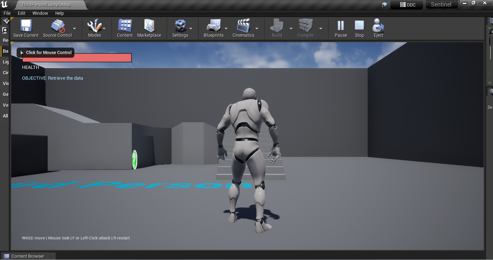
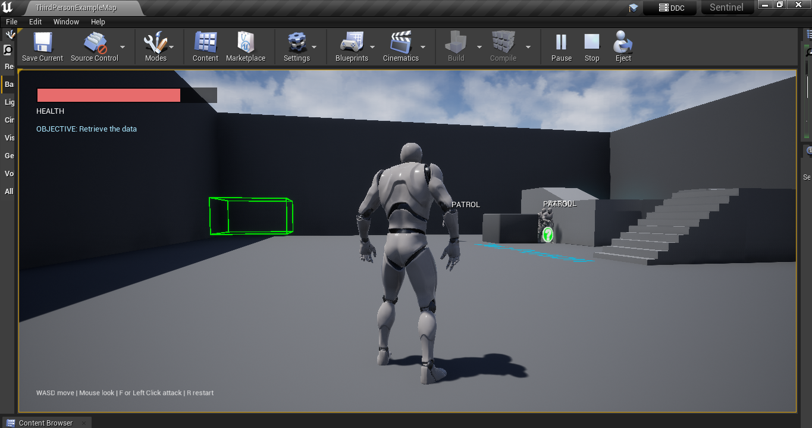
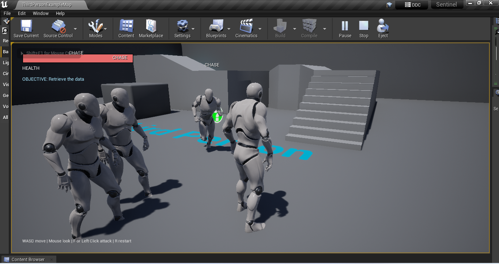
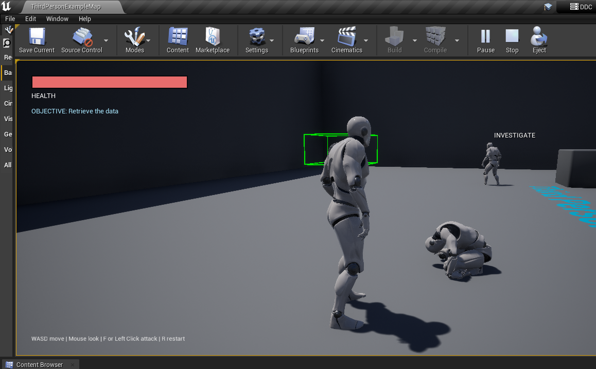
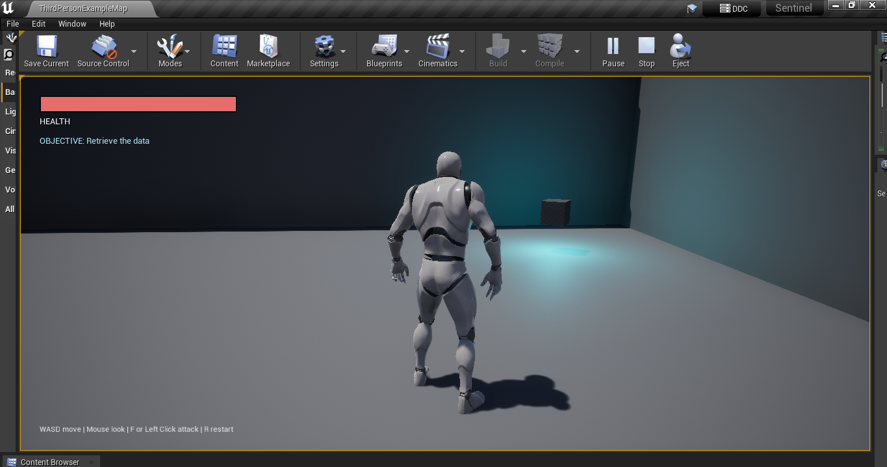
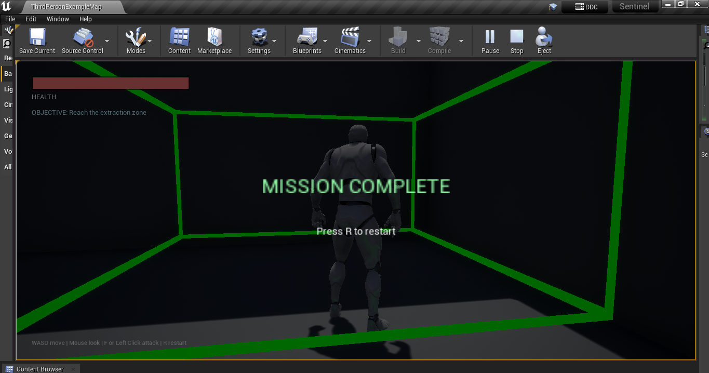
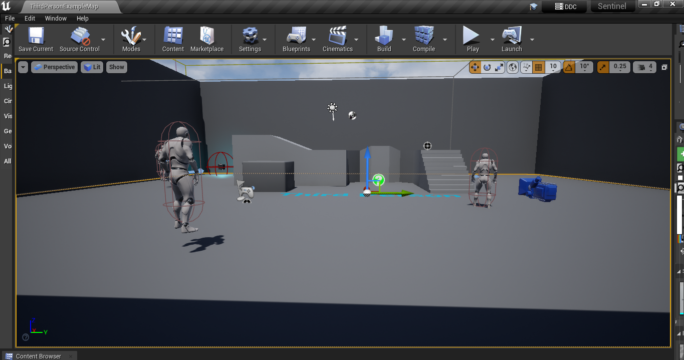
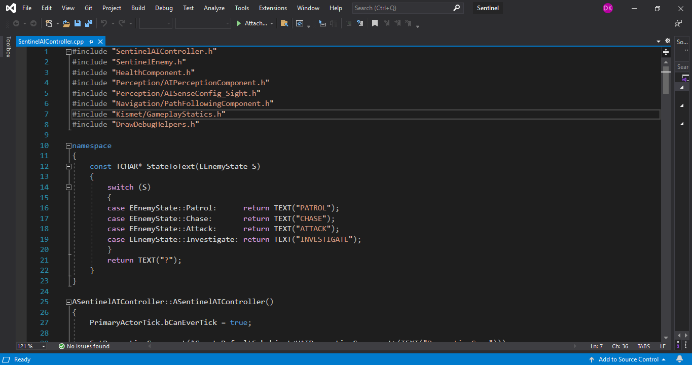
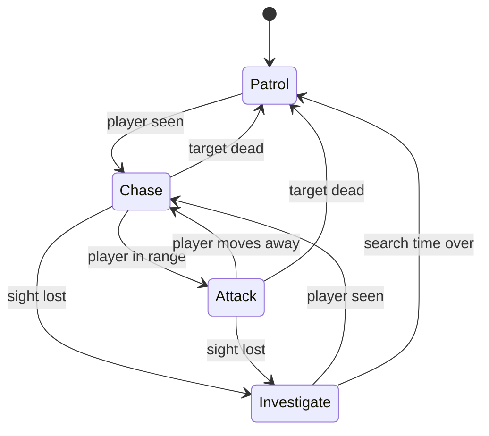

# Project Sentinel

A stealth and extraction gameplay prototype built in Unreal Engine with C++. The player must retrieve a data drive from guarded ground and reach the extraction zone without being killed by the patrolling guards.

## Demo Video

▶️ [Watch Project Sentinel — Unreal Engine C++ Gameplay Programming Demo](https://youtu.be/b2oFv5Xs6tY)

Demo video: https://youtu.be/b2oFv5Xs6tY

## Screenshots

| | |
|---|---|
|  |  |
| Health bar and objective | Guard on patrol |
|  |  |
| Guard chasing and attacking | Guard investigating the last known position |
|  |  |
| Data pickup | Mission complete |
|  |  |
| Navigation mesh | State machine code |

## Gameplay

1. Sneak past or fight the guards.
2. Pick up the glowing data drive.
3. Reach the green extraction zone to complete the mission.
4. If your health reaches zero, the mission fails. Press **R** to restart at any time.

**Controls:** WASD move, mouse look, F or left click attack, R restart.

## Systems

- **Enemy AI:** a finite state machine with Patrol, Chase, Attack and Investigate states.
- **AI Perception:** sight-based detection. When a guard loses sight of the player it remembers the last known position, walks there and searches before returning to patrol.
- **NavMesh navigation:** patrol routes, chasing and searching all use Unreal's navigation system.
- **Health component:** a reusable component driven by Unreal's damage event, shared by the player and the guards. It broadcasts delegates for health changes and death.
- **Combat:** player melee attack using a sphere sweep with a cooldown. Guards attack with a range check and a cooldown, and ragdoll when they die.
- **Mission system:** data pickup, extraction zone, win and lose states, and level restart, owned by the game mode.
- **HUD:** health bar, objective text, hints and the mission result, drawn in C++ without UMG assets.
- **Debug visualisation:** the current AI state is drawn above each guard, and the extraction zone and attack sweep are drawn in the world.

### Enemy state machine

## Code overview

| File | Responsibility |
|---|---|
| `HealthComponent` | Health, damage handling, health and death events |
| `SentinelEnemy` | Guard body: patrol points, speeds, attack, ragdoll death |
| `SentinelAIController` | Guard brain: perception and the state machine |
| `SentinelCharacter` | Player movement, camera, melee attack, death handling |
| `SentinelGameMode` | Mission rules and state |
| `ObjectivePickup` | The data drive |
| `ExtractionZone` | The extraction trigger |
| `SentinelHUD` | On-screen display |

Source files are in `Source/Sentinel`.

## Design notes

- Behaviour is separated from the body: `SentinelEnemy` holds data and actions, and `SentinelAIController` makes the decisions.
- Health is a component, so any actor can use it, and anything that calls Unreal's damage function works with it.
- The attack range uses hysteresis: a guard starts attacking in range but only goes back to chasing at 1.3 times that range, to avoid flickering between states.
- Path requests while chasing are sent a few times per second rather than every frame.
- Components that don't need to update every frame have ticking disabled.

## Performance

Measured with `stat unit` in the editor (Play In Editor) on a laptop with a Ryzen 3 7320U, integrated graphics and 8 GB RAM. In a normal scene the frame time was about 17 to 20 ms, the game thread about 9 to 12 ms and the GPU about 17 to 20 ms, so the scene is GPU-bound on this hardware and the gameplay code is not the bottleneck. These are single samples from the editor, not a packaged-build benchmark.

## Building

Requirements: Unreal Engine with C++ support, and Visual Studio with the "Game development with C++" workload.

1. Clone the repository.
2. Right-click `Sentinel.uproject` and choose **Generate Visual Studio project files**.
3. Open `Sentinel.sln` and build the **Sentinel** project in the **Development Editor** configuration.
4. Open `Sentinel.uproject`, open the level, and press Play.

## Roadmap

- Replace the C++ state machine with a Behavior Tree for comparison.
- Add a hearing sense so noise can alert guards.
- Add a UMG-based interface and sound.
- Add automated tests for the health and mission logic.

## Links

- Portfolio: https://deepak-game-dev.github.io
- YouTube channel: https://www.youtube.com/@DeepakGameDev
- LinkedIn: https://www.linkedin.com/in/deepak-game-dev/

## Credits

The character model and animations come from Epic's Third Person template.
